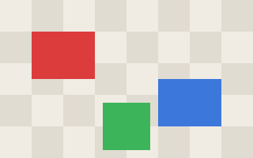

# Thumbnail review

Here is the current scene, and a short clip. Pictures and media are loaded
relative to this file; links such as the [askdown repository](https://github.com/cyberneura/askdown)
open in your browser.



<video src="media/clip.mp4" controls muted></video>

```askdown
id: thumbnail
type: media-choice
question: Which picture should be the thumbnail?
required: true
options:
  - { label: Scene, value: scene, src: media/scene.png, description: Three blocks on a tiled floor }
  - { label: Checker, value: checker, src: media/checker.png }
  - { label: Clip, value: clip, src: media/clip.mp4, description: The test clip }
```

```askdown
id: focus
type: point
question: Click the block the camera should focus on.
src: media/scene.png
required: true
```

```askdown
id: moments
type: point
question: Mark a few spots in the clip (seek first, then click the frame). Click a marker to remove it.
src: media/clip.mp4
multiple: true
```

```askdown
id: crop
type: draw
question: Draw the crop area on the scene.
src: media/scene.png
```

```askdown
id: sketch
type: draw
question: Sketch the layout you have in mind (blank sheet).
width: 480
height: 320
```

```askdown
id: accent
type: color
question: Pick an accent colour for the title.
default: "#e0245e"
```

```askdown
id: chorus
type: range
question: Where is the chorus? Mark where it starts and ends.
src: media/tone.wav
```

```askdown
id: cut
type: range
question: Which part of the clip should be kept?
src: media/clip.mp4
default: { start: 1, end: 2.5 }
```
